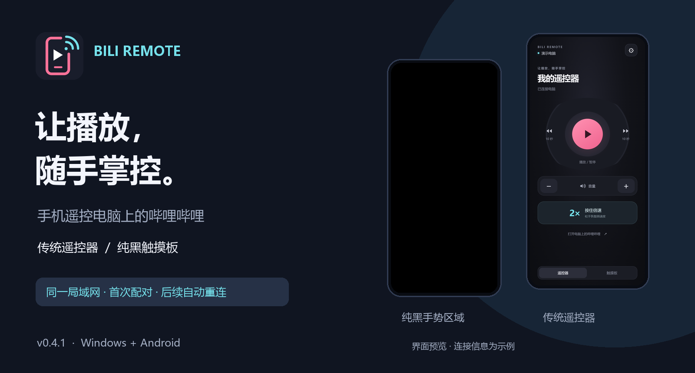

# 哔哩哔哩遥控器 · Bili Remote

用安卓手机遥控电脑上的哔哩哔哩：轻点暂停，滑动调节，按住临时倍速。

**当前版本：0.4.1** · Windows + Android · 局域网连接 · 无需浏览器扩展

## 先从这里开始

| 你想做什么 | 阅读文档 |
| --- | --- |
| 第一次安装并连上电脑 | [快速上手](docs/QUICK_START.md) |
| 学习手势、切换样式、选择播放器 | [完整使用指南](docs/USAGE.md) |
| 电脑搜不到、连不上、操作没反应 | [常见问题与排查](docs/FAQ.md) |
| 从源码运行、打包、验证升级 | [开发与构建说明](docs/DEVELOPMENT.md) |
| 了解图片来源或重新生成配图 | [文档配图说明](docs/images/README.md) |

## 能做什么

- **两种遥控样式**：传统按键遥控器、纯黑全屏触摸板，记住上次选择。
- **四种基本操作**：播放 / 暂停、音量、进度、长按临时倍速。
- **首次配对，之后重连**：电脑广播在线信号；手机自动搜索，已配对的电脑自动重连。
- **手动 IP 备用**：保存最近地址，也能通过稳定的电脑标识寻找变化后的 IP。
- **电脑端可见反馈**：短暂操作提示、最近操作记录、托盘和可选开机自启。
- **两端覆盖升级**：直接安装新版，保留设置和配对，升级时无需先卸载。

*手机图为当前 WebView 页面的渲染预览，使用示例电脑与连接数据；不代表已完成所有安卓机型的实机验证。*

## 安装与连接

1. 电脑安装 `BiliRemote-Setup.exe`，手机安装 `bili-remote-debug.apk`。电脑无需安装 Python。
2. 两端接入同一路由器；电脑接网线、手机连 WiFi 也可以。打开电脑软件。
3. 手机自动发现电脑，首次输入电脑端显示的 **6 位配对码**。
4. 在电脑软件点击 **“打开哔哩哔哩 · 无需扩展”**，在打开的播放窗口中选一个视频。
5. 手机开始遥控。后续保留授权，电脑在线时可自动重连。

安装包由维护者提供，构建输出位于 `dist/`；Git 源码下载包不包含安装包。已有构建文件时只需要上面两个文件，其余文件的用途见[安装包说明](docs/FAQ.md)。

详细步骤与连接界面见[快速上手](docs/QUICK_START.md)。

## 怎么操作

| 想做什么 | 纯黑触摸板 | 传统遥控器 |
| --- | --- | --- |
| 播放 / 暂停 | 任意位置轻点 | 中央播放键 |
| 调节音量 | 上滑增大，下滑减小 | `+` / `−`，每次 5% |
| 快进 / 快退 | 右滑 / 左滑，松手跳转 | 左右按键，每次 10 秒 |
| 临时倍速 | 按住约 0.5 秒 | 按住倍速键 |
| 恢复原速度 | 松手 | 松开倍速键 |
| 打开设置 | 双指触摸，或 Android 返回键 | 右上角齿轮，或返回键 |

倍速可设为 1.5 / 2 / 3 / 4。松手恢复按下前的速度，例如原本 1.5 倍，松手后仍为 1.5 倍。更多细节见[使用指南](docs/USAGE.md)。

## 播放器与运行要求

| 项目 | 支持范围与要求 |
| --- | --- |
| 电脑 | Windows 10 1809 或更新的 64 位 Windows |
| 手机 | Android 8 或更新版本 |
| 网页视频 | 使用电脑软件自动打开的 Edge / Chrome 播放窗口，无需扩展 |
| Windows 哔哩哔哩客户端 | 尝试通过客户端提供的媒体接口控制；能力取决于实际版本 |
| 网络 | 同一局域网，设备之间允许通信；通常无需手动填 IP |

**网页完整控制作用于本软件打开的专用播放窗口。** 该窗口使用独立浏览器资料，首次可能需要重新登录哔哩哔哩；平时浏览器中已有的普通标签页无法保证直接受控。

Windows 客户端是否支持暂停、进度和倍速，由客户端开放的接口决定。软件能检测版本及实际能力，**不保证所有版本全部功能可用**。接口不支持时会反馈失败；需要完整手势控制时，优先使用专用网页播放窗口。

## 升级与数据

**直接安装新版，不要先卸载旧版。** Windows 沿用旧目录，原本正在运行时会在升级后恢复到托盘；安卓确认系统的“更新”即可。电脑和手机的设置、配对及 IP 记录会保留。升级期间遥控短暂断开，专用播放窗口会关闭，之后可重新打开。

当前没有自动下载更新功能，需要自行运行新版安装包。升级前提、数据保留范围和卸载说明见[使用指南](docs/USAGE.md)。

## 连接与隐私

配对码只用于首次认证，后续使用每部手机保存的独立凭据。局域网广播不包含配对码或授权密钥。当前版本使用局域网明文通信，适合可信家庭网络，尚未提供 TLS 加密；不应把控制端口直接暴露到公网。

本项目是第三方遥控工具，与哔哩哔哩官方无隶属关系。软件功能及当前验证范围见[开发说明](docs/DEVELOPMENT.md)。
