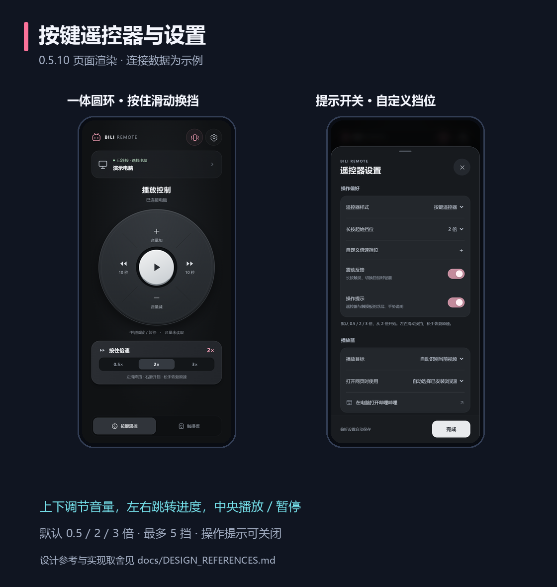

# 遥控器设计参考

[项目首页](../README.md) · [使用指南](USAGE.md)

0.4.4 的界面调整参考了以下实际打开查看的页面，查看日期为 2026-10-21。第三方作品仅用于比较布局；项目未复制其图片、图标或源代码。

| 来源 | 参考的部分 | 本项目的实现 |
| --- | --- | --- |
| [Apple 官方：设置 Apple TV 遥控器](https://support.apple.com/zh-cn/108778) | 集中的设备选择入口、首次配对后继续使用的连接流程 | 顶部设备卡片展示真实连接状态，点击进入连接设置；沿用首次配对与已授权自动重连 |
| [Nikita Prokofyev / ScreensLab：TV Remote Control](https://dribbble.com/shots/27044893-TV-Remote-Control-Mobile-App-Interface-Design) | 一体圆环、中央主键、克制的深色层次与设备胶囊 | 哑光深灰圆环与银白播放键，使用细边、接触阴影和按下位移表现层次；粉色只强调震动开启与倍速状态 |

## 调整后的界面

图中是当前页面的实际渲染，电脑名称、地址与连接响应为隔离示例数据。不是实体手机截图。

- **主控区**：音量在中央播放键上、下方，快退和快进在左、右方；四个控制区共享圆环表面，按钮与文字全部留在圆内。保留至少 44 像素的触控目标。
- **倍速区**：单个按住区域显示已配置的 1–5 挡轨道，默认 0.5× / 2× / 3×。灰色表示起始挡位，按住后当前挡位高亮为粉色；按住左右滑动换挡，松手恢复。
- **设置面板**：连接电脑、操作偏好、播放器分别成组，手动地址和手势说明折叠；内容独立滚动，标题、关闭与完成按钮保持可达。
- **状态与图标**：连接状态来自实际连接回调，音量来自电脑返回值；不展示虚构的视频标题、播放进度或电量。图标使用本地 SVG，不依赖在线字体或图片。
- **小屏与横屏**：缩小圆盘和间距，空间不足时允许纵向滚动，不挤压或重叠按钮。纯黑触摸板继续沿用全屏手势。

设置分组按照本项目已有功能设计，没有添加尚未实现的主题、皮肤、亮度或设备电源选项。

## 电脑端 · 0.5.2

查看日期为 2026-10-22，以下为实际打开阅读的 Apple 官方资料。参考信息组织、留白和交互层级，未复制 Apple 图片、SF Symbols、字体或源代码。

| 来源 | 参考的部分 | 本项目的实现 |
| --- | --- | --- |
| [Apple：Designing for macOS](https://developer.apple.com/design/human-interface-guidelines/designing-for-macos) | 可调整窗口、键盘操作、适合桌面的信息密度 | 按 Windows 工作区确定窗口尺寸；连接信息响应式双栏；侧栏支持 Alt+1–4；小窗口可滚动 |
| [Apple 支持：通过“系统设置”自定义 Mac](https://support.apple.com/zh-cn/guide/mac-help/mh15217/mac) | 侧栏导航、分组设置和清晰的主次关系，页面内含系统设置截图 | 浅灰侧栏、白色分组卡片、蓝色选中态；设置按通用、提示字幕、帮助与管理分组，开关放在每行右侧 |

使用 Windows 本地字体和原生窗口标题栏，圆角元素、线性图标由本项目绘制。0.5.10 界面使用 Qt Widgets 光栅双缓冲，没有 WebView / Electron、实时模糊或切页动画；手机发现、首次配对和已授权重连流程保留。颜色与文字共同表达真实状态，未连接时不会显示虚构播放内容。

## 电脑端 · 0.5.6

本次继续实际查看 Apple 官方系统设置参考截图，并扩展阅读布局、字体、颜色、侧栏、设置、滑块、动效和无障碍指南。完整原则、实现对应关系、持续字幕编辑与清晰度策略见[电脑端设计说明](DESKTOP_DESIGN.md)。

## 电脑滚动与绘制 · 0.5.7

实际阅读 Qt QScrollArea、QWidget 和 VS Code Scrollable 源码 / 文档，采用独立裁剪视口、内容移动、合并输入和按时间推进的原则，并阅读 Windows 子窗口滚动与分层窗口限制。具体链接、实现对应与同机复测结果见[渲染优化](RENDERING.md)。该阶段保留 Tk；0.5.10 已替换为 Qt Widgets 的统一双缓冲，未加入网页引擎。

## 启动、版本与无动画切页 · 0.5.10

实际阅读 PyInstaller 单文件 / 目录模式、Tkinter 线程模型、Windows 分层绘制及 GitHub 发布 API 文档，改为安装时展开依赖、无页面动画和按需滚动缓存，后台检查自身版本。测量方法与已知边界见[性能说明](RENDERING.md)。

## 0.5.10 绘制层更换

复查旧代码与连续屏幕记录后，删除混合原生子控件、分层缓存及外部位移的路径。阅读 Qt QWidget 双缓冲、QBackingStore 与 Tk Windows 窗口源码，改为普通非原生 Qt 子控件。对比方法、性能代价与边界见[绘制说明](RENDERING.md)。
