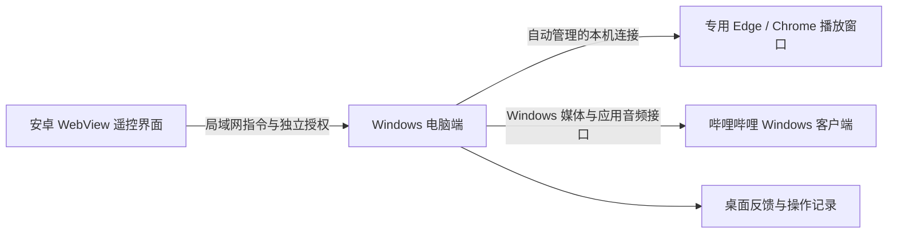

# 开发与构建说明

[项目首页](../README.md) · [使用指南](USAGE.md) · [常见问题](FAQ.md)

本页面向维护者。当前项目版本为 **0.5.6**，安卓 `versionCode` 为 **16**。主要开发环境为 Windows、Python 3.12、JDK 17 和 Android SDK 35。

## 项目结构

```text
android/                 安卓 Activity、WebView 资源与图标
desktop/                 Windows 窗口、播放控制、发现、授权与反馈
installer/               Inno Setup 安装、升级和卸载
scripts/                 打包、自检、升级验证和文档配图生成
tests/                   Python 与 Node 测试
docs/                    使用文档及配图
dist/                    构建产物，不进入 Git
.tooling/                本地工具与临时验证文件，不进入 Git
```

## 本地运行电脑端

```powershell
python -m venv .venv
.\.venv\Scripts\python.exe -m pip install -r requirements-dev.txt
.\.venv\Scripts\python.exe run_desktop.py
```

源码启动需要 Python；安装包用户不需要。电脑端以普通用户权限运行，无需安装 Windows 服务。依赖中的 Windows Runtime 和音频接口需要 Windows 环境。

## 两条播放控制路径



网页路径使用系统已安装的 Edge / Chrome，以独立资料目录启动浏览器，通过仅绑定本机回环地址的随机调试端口控制。无需扩展，也不捆绑浏览器内核。普通浏览器标签页不保证受控。

客户端路径使用 GSMTC 检查与调用媒体会话、使用 pycaw 控制应用音频会话。`discover` 返回暂停、进度、倍速等实际可用能力。“客户端与版本”页可见时每 15 秒更新运行状态，每 60 秒刷新安装记录，手动检测可立即刷新；后台暂停扫描。未知版本显示“未知”，未运行的便携客户端可能无法从安装记录发现。

音频排查可使用命令行服务指定进程名，例如将 `实际进程名.exe` 换成客户端真实进程：

```powershell
.\.venv\Scripts\python.exe -m desktop.server --audio-process 实际进程名.exe
```

这是命令行服务参数，不是桌面 GUI 启动参数。不要把 `run_desktop.py --audio-process ...` 当成已实现的配置入口。

## 网络与授权

| 通道 | 默认端口 | 用途 |
| --- | --- | --- |
| TCP / WebSocket | 8765 | 接收控制和认证 |
| UDP，电脑监听 | 8766 | 回复手机发现请求 |
| UDP，手机监听 | 8767 | 接收电脑每 2 秒发送的在线广播 |

手机主动扫描与被动监听并用。广播包含电脑名称、稳定标识及端口，不包含 PIN 或授权密钥。首次使用 6 位 PIN 认证，后续使用每部手机的随机密钥；PIN 每 10 分钟刷新，有错误配对限流。

当前局域网通信未实现 TLS，不提供抵御恶意网络监听或中间人攻击的加密保障。独立授权不能代替传输加密。适用于可信局域网，不应直接开放公网端口。

## 本地数据

Windows 默认目录：`%LOCALAPPDATA%\BiliGestureRemote`。

| 文件 / 目录 | 内容 |
| --- | --- |
| `trust.json` | 稳定电脑标识及已授权手机凭据 |
| `settings.json` | 电脑端偏好 |
| `remote.log`、`.1`、`.2` | 错误日志，最多 3 个文件，每个 256 KiB |
| `browser-profile/` | 专用播放窗口的资料与登录数据 |

安卓通过 `remote` SharedPreferences 保留手机标识与设置 JSON，包括授权、地址记录、样式、目标和倍速。覆盖安装保留应用数据，卸载或清除数据不会保留这些记录。

不要把授权文件、浏览器资料、真实配对码或签名私钥提交到 Git。单独备份并妥善保管原安卓签名；公开证书指纹不能恢复私钥。

## 构建 Windows 安装包

安装 PyInstaller 和 Inno Setup 6 后执行：

```powershell
.\.venv\Scripts\python.exe -m pip install pyinstaller
.\.venv\Scripts\python.exe scripts/build_desktop.py
.\.venv\Scripts\python.exe scripts/build_installer.py --compiler "C:\Program Files (x86)\Inno Setup 6\ISCC.exe"
```

若使用本项目本地工具缓存中的编译器，可省略 `--compiler`。脚本默认检查 `.tooling/inno/ISCC.exe`，不会自动安装 Inno Setup。编译前确认使用场景符合构建工具的许可。

构建得到 `dist/BiliRemote-Desktop.exe` 与 `dist/BiliRemote-Setup-0.5.6.exe`。普通用户分发安装器即可。

分发文件名自动读取安卓 `versionName` 和 Windows `AppVersion`，两端版本不一致时停止打包。电脑安装器、安卓 APK、整合 ZIP 和校验 JSON 均带版本号，本文以 0.5.6 为例。`BiliRemote-Desktop.exe` 是安装器使用的内部程序文件，保留固定名称以维持自启、单实例和覆盖升级路径。Android Studio / Gradle 构建的 APK 也使用带版本号的名称。

安装器固定 AppId，沿用实际旧安装路径，正常退出运行中的程序后替换文件。升级不调用旧卸载器，避免清空数据。保留实际自启和桌面快捷方式状态，原本运行的实例安装后恢复到托盘。支持同版本修复，拒绝较低版本降级。

真正卸载才清理程序、自启、登记、授权和专用资料；清理该程序的防火墙规则可能需要管理员权限，拒绝时会提示，静默卸载写日志。

## 构建安卓 APK

Android Studio 可以打开 `android/`；Windows 也可使用便携构建脚本：

```powershell
.\.venv\Scripts\python.exe scripts/build_apk.py
```

脚本把 JDK 和 Android 工具下载到 `.tooling/`，生成并验证 `dist/bili-remote-0.5.6.apk`。无需安装到全局工具路径。便携构建中的 Java / javac 使用 256 MiB 堆上限和 2 个可见处理器，降低工作站内存紧张时的构建峰值；这是构建工具限制，不是安卓 App 的运行时内存配置。

**从新克隆的仓库不能直接生成可覆盖现有用户版本的 APK。** 维护者必须先把原签名恢复到 `android/signing/app.keystore`。该私钥不在仓库中；旧项目若仍有 `.tooling/debug.keystore`，脚本会核对证书后复制原密钥。密钥缺失或不匹配时停止，不会静默生成不同身份。

Python 便携构建、Gradle debug 和 release 构建均使用同一签名，并与 `android/signing/certificate.sha256` 核对。历史密钥是开发签名，沿用它是为了覆盖兼容，不能据此声称已具备生产分发的密钥管理。细节见[仓库签名说明](https://github.com/Nichijin/bili-remote/blob/main/android/signing/README.md)。

发布新版本时保持 `applicationId` 为 `com.biliremote.app`，递增 `versionCode`，更新 `versionName` 和 Windows 安装器的 `AppVersion`。签名、包名和数据存储位置改变都需要明确的迁移设计，不能只改版本名称。

## 测试与升级验证

```powershell
.\.venv\Scripts\python.exe -m pytest -q
node --test tests/*.test.cjs
.\.venv\Scripts\python.exe scripts/smoke_gui.py
.\.venv\Scripts\python.exe scripts/smoke_desktop_layout.py
.\.venv\Scripts\python.exe scripts/smoke_feedback.py
.\.venv\Scripts\python.exe scripts/smoke_desktop_responsiveness.py
.\.venv\Scripts\python.exe scripts/measure_desktop_responsiveness.py --output .tooling/responsiveness.json
.\.venv\Scripts\python.exe scripts/smoke_installer.py
.\.venv\Scripts\python.exe scripts/smoke_upgrade.py --baseline .tooling/upgrade-baseline-0.5.2
.\.venv\Scripts\python.exe scripts/verify_apk_upgrade.py 旧版.apk dist/bili-remote-0.5.6.apk
```

遥控器布局另可运行 `python scripts/smoke_remote_layout.py`（需要 `pip install playwright` 和本机 Edge / Chrome）。它用隔离连接夹具验证 7 种屏幕尺寸下的圆环边界、上下左右位置、至少 44px 触控区域和按键指令；并使用真实指针事件检查两种模式的长按切挡、震动、5 挡设置、提示开关保存及连续进度，不代表安卓实机测试。`smoke_desktop_layout.py` 检查 7 组窗口与字体缩放下的真实侧栏导航、按钮换行、底部操作可达、表格滚动及新版滑块指针拖动，不等同于真实多显示器 DPI 切换测试。

升级基线目录需包含原 `BiliRemote.iss` 和 `BiliRemote-Desktop.exe`。升级冒烟脚本从旧新安装脚本读取版本，当前使用 0.5.5 → 0.5.6 的基线验证。安装与升级冒烟脚本会使用独立程序身份、目录和端口，不应测试在用户正式安装上。

| 已验证范围 | 当前证据 |
| --- | --- |
| 播放控制 | 真实无头 Edge / Chrome、本地媒体夹具，覆盖暂停、进度、音量、临时倍速及恢复 |
| 配对与连接 | PIN、保存凭据重连、广播、IP 改变和手势测试 |
| 桌面反馈 | GUI 冒烟、浮层不抢焦点及操作记录 |
| Windows 覆盖 | 独立身份的实际安装、重连、保留数据、自启、同版本修复、拒绝降级及干净卸载 |
| Android 更新包 | 旧新 APK 包名、证书和版本代码一致性检查 |
| 仍待补充 | 实体安卓 WiFi、多品牌系统、真实触摸、实体手机覆盖安装及各版哔哩哔哩客户端兼容 |

文档截图使用示例状态，不算作真实网络或实体手机测试结果。

临时倍速使用 `speed_start`、`speed_change`、`speed_keep`、`speed_end`。切挡固定路由到当前长按持有的控制器及播放器，不能重新挑选目标或覆盖最初速度；页面和电脑端的超时机制继续负责恢复。手机的震动回调仅在进入长按或挡位实际改变时触发，Android Bridge 在主线程调用短促振动，受持久化开关和窗口前台状态约束。

`config.gears` 为升序、唯一的 1–5 个允许倍速，`config.rate` 必须属于该列表；未配置时迁移为 `[0.5,2,3]`，默认起始 2 倍。`config.show_hints` 控制两种模式的操作浮层与手势说明，独立于 `config.haptics`。

连续进度通过 `status` 获取当前位置、`seek_start` / `seek_end` 和 `media_key`，再发送带小数秒的 `seek_to(position, media_key)`。横向整屏对应 120 秒，发送间隔约 80ms、最多一个未完成请求，快速移动合并为最新位置，松手补发最后位置。下一次拖动在前一次最终请求后读取基准；取消、后台或断线丢弃尚未发送的位置，不回滚已提交进度。网页使用视频元素及媒体源标识，客户端使用会话、范围和媒体属性摘要校验，避免旧拖动落到已变化的视频。客户端缺少媒体信息或时间轴时明确报错。

`desktop/appearance.py` 使用 Pillow 将本地几何图形以 4 倍尺寸抗锯齿绘制，再生成 Tk 主题元素；卡片使用单一主题容器。圆角、开关、滑块、细滚动条及线性图标按设备像素生成并缓存，普通缩放不重新生成纹理。0.5.6 取消固定阅读宽度与居中，两层页面容器均铺满可用区域，只保留左右 14 个逻辑像素内边距；窗口尺寸变化时按实际可用宽度布局，切页复用已准备页面；没有浏览器界面内核、运行时图片下载或常驻动画。`desktop/rendering.py` 使用 Windows 分层子窗口保留完整页面，菜单切换层级并使用原生 `SetWindowPos` 将目标页面按菜单方向短距离上下滑入，约 200 ms；`desktop/navigation.py` 在固定文字和图标下绘制移动选中背景，与页面共用一个动画计时器。目标约 60 帧 / 秒，按真实经过时间推进，迟到时跳到当前位置，不堆积补帧；逐帧只移动已有 HWND 与 Canvas 图像坐标，不重新布局、生成图片或调用 `update()`；目标控件从第一帧就接受输入。启动时读取 Windows 客户区动画偏好，系统关闭动画时直接切页；原生合成不可用时自动恢复普通 Tk 绘制。原生 Windows 标题栏保留最小化、最大化和关闭。

`desktop/layout.py` 负责工作区窗口尺寸、滚动页面、文字换行和按钮行换行；`desktop/assets/app.manifest` 声明 Per Monitor V2，打包脚本嵌入该清单。

`desktop/feedback.py` 负责字幕样式规范化、工作区定位和不激活窗口的显示；`settings.json` 的 `feedback_style` 保存 `x` / `y` 百分比、`font_size`、`color` 和 `opacity`。`show_feedback` 沿用旧版开关字段。设置写入防抖 250ms，关闭程序时提交待保存内容；`desktop/subtitle_preview.py` 提供页内持续预览、直接拖动及方向键微调；显式打开的屏幕编辑预览持续显示且可以拖动，普通操作反馈仍鼠标穿透、不抢焦点。离开设置、隐藏窗口或按 Esc 结束编辑。字幕关闭时释放窗口、开启后按需重新创建，重复操作只保留一个隐藏计时器。`smoke_subtitle_editor.py` 检查持续显示、拖动边界、同步修改、保存、焦点及关闭清理；`smoke_feedback.py` 用隔离设置验证真实窗口样式、位置、保存、300 次复用与不抢焦点。

客户端检测由当前页可见状态和手动请求驱动；后台暂停扫描不会影响广播、连接和实际控制。扫描结果不变时不重建表格。避免在启动阶段主动调用 WinRT 媒体接口；实际客户端控制仍按需加载。

可比较旧版与新版打包程序的后台内存，分别使用下面的命令。测试创建独立身份与数据目录，测量全部程序子进程的工作集和私有字节，不启动播放器、不触碰正式安装，也不裁剪工作集。可加 `--visible` 测量主窗口显示时的页面缓存占用；它与后台待机数据分开报告。默认重复 3 次，启动服务后等待 5 秒，6 次采样取中位数，再对各次运行取中位数。

```powershell
.\.venv\Scripts\python.exe scripts/measure_desktop_memory.py .tooling/upgrade-baseline-0.5.0/BiliRemote-Desktop.exe --output .tooling/memory-0.5.0.json
.\.venv\Scripts\python.exe scripts/measure_desktop_memory.py dist/BiliRemote-Desktop.exe --output .tooling/memory-0.5.6.json
```

## 交互性能复测

`measure_desktop_responsiveness.py` 使用独立数据目录、不启动网络和检测服务，测量菜单切换到 Tk 绘制队列排空的耗时、首次设置开关输入、过渡结束、30 次滑块指针移动及窗口尺寸变化，不仅计时按钮回调。`--source-root` 可指向旧版源码目录做同机对比；`--rounds` 默认为 3，`--resize-steps` 默认为 12，`--profile` 可选生成 cProfile 文件。每次切页后等待过渡完成再测下一次，首次设置操作在过渡期间发送，分别报告首帧可用与动画结束，避免把动画时间算成输入等待。`--min-width` / `--max-width` 可覆盖窄窗口范围；全宽页面缩放涉及重排，需同时报告中位数及峰值，避免只用中位数隐藏重排峰值。比较时两版使用相同参数，按顺序运行，不并行启动其他 GUI 测试。它是桌面源程序的隔离测量，不能代表所有电脑、所有播放器负载或安卓网络延迟。

`smoke_desktop_responsiveness.py` 检查反复切换后控件身份、设置和滚动位置保留；Tab 跳过后台页；1200 条操作反馈不会阻塞其他界面回调、顺序保留、最近 100 条日志及失败颜色正确；悬停提示显示期间退出可正常清理。`smoke_desktop_transitions.py` 使用 Windows 原生命中测试及真实鼠标点击确认淡入期间可立即切换设置；Windows 锁屏时改用 Tk 指针事件并明确记录原生输入未验证，不把锁屏期间的测试当作物理鼠标验证，检查 120 次快速切页、透明度还原、GDI / 图像复用、缩放后切页无布局事件、最小化及退出清理、减少动画和普通 Tk 回退。测试会短暂置顶独立窗口并恢复鼠标位置。`smoke_menu_motion.py` 测量共享动画的帧间隔、正反方向、动画期间输入、连续反向切换无跳回及缩放 / 隐藏 / 退出清理；计时不包括显示器实际扫描输出，不能保证所有硬件始终不掉帧。

## 分发整合包

两端构建完成后，可生成可选整合包和校验文件：

```powershell
.\.venv\Scripts\python.exe scripts/package_kit.py
```

产物是 `dist/bili-remote-kit-0.5.6.zip` 与 `dist/SHA256-0.5.6.json`，整合包包含两端安装文件、README 和完整图文文档，校验值使用相对路径区分同名文件。普通用户只需要 Windows 安装包与 Android APK，无需下载全部构建辅助文件。安装包不纳入 Git 历史，可另行作为发布附件分发。

整合脚本只接收当前版本的两端安装包；缺少任一文件即停止，不会回退到无版本号文件或把旧版本混入新整合包。修改项目版本后会生成新的文件名，旧版带版本号的产物不会被覆盖。

电脑程序和 Windows 安装器同时打包 `docs/`，让安装后的说明可以访问本地配图。更新文档后重新构建才会更新本地安装包，GitHub 文档更新不会自动替换用户电脑中的文件。

## 图标与文档图片

图标源文件在 `desktop/assets/` 和 `android/artwork/`。图标绘制脚本为 `scripts/draw_icon.py`、`scripts/draw_android_icon.py`。0.5.5 起电脑运行时也使用 Pillow 生成抗锯齿主题素材，依赖已写入 `requirements.txt` 并打入 EXE；用户无需另行安装。安卓提供自适应图标与 Android 13 单色图标，电脑使用原生托盘。

文档图片的可复现生成方式见[配图说明](images/README.md)。更新界面后同步重渲染，避免文档与软件实际入口不一致。
