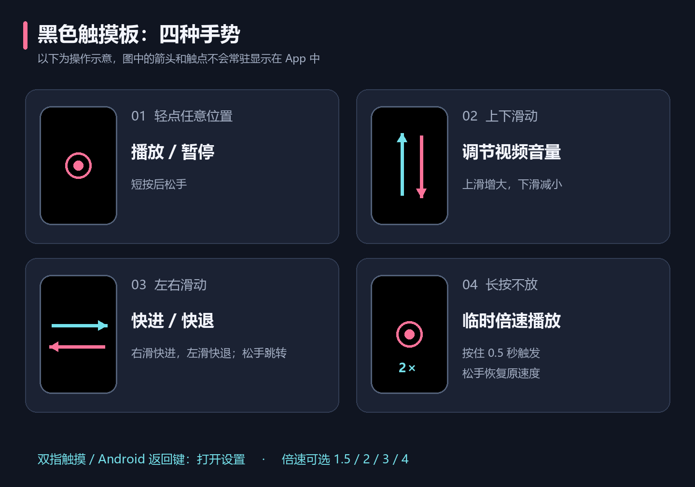
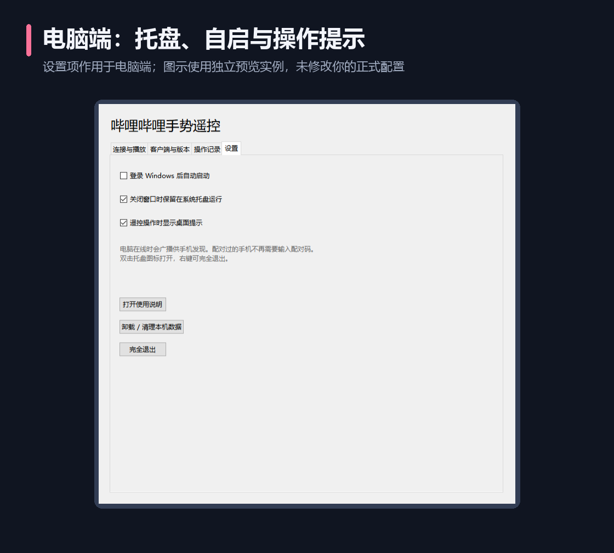

# 常见问题与排查

[项目首页](../README.md) · [快速上手](QUICK_START.md) · [完整使用指南](USAGE.md)

## 先判断是哪一类问题

| 现象 | 优先检查 |
| --- | --- |
| 手机搜不到电脑 | 电脑端在线、同一路由器、网络隔离和防火墙 |
| 找到电脑但无法配对 | 实际配对码、过期或输错、错误次数限制 |
| 显示已连接，视频没反应 | 播放窗口是否受软件管理、目标是否正确、客户端能力 |
| 手机全黑，没有按钮 | 当前是否是纯黑触摸板；双指触摸或返回键打开设置 |
| 电脑没有操作提示 | 桌面提示开关、操作记录是否收到命令 |
| 新 APK 无法覆盖 | 是否沿用原包名与签名、是否是更低版本 |

## 手机搜索不到电脑

按以下顺序检查，通常不需要重新安装：

1. 电脑端主界面应显示已在线；若显示服务启动失败，先解决该错误。只打开安装器不等于电脑端已运行。
2. 手机连接 WiFi，电脑接入同一路由器。电脑有线、手机无线可以使用；同一 WiFi 名称也不一定代表设备之间允许互相通信。
3. 检查是否使用访客 WiFi、路由器 AP / 客户端隔离、VPN 或多网卡分流。这些设置可能阻止广播或局域网访问。
4. 在 Windows 防火墙中允许本程序访问当前可信的专用网络，不要直接关闭整个防火墙。
5. 手机点“重新扫描”；仍无结果时，使用电脑端显示的 IPv4 地址手动连接。


手动 IP 也失败时，说明不只是广播发现失败，应继续检查地址、网络互通、防火墙及电脑服务状态。不要把家里电脑的控制端口直接映射到公网。

## 为什么还需要配对码

自动发现负责找到电脑，配对码负责确认这台手机得到允许。首次输入一次，授权保存在两端；后续自动连接不需要反复输入。自动发现的广播本身不包含配对码和授权凭据。

电脑配对码每 10 分钟刷新；错误码、已过期的码应重新查看电脑端。提示失败次数过多时，等待约一分钟再试，不要连续提交。

## 原来配对过，现在又要求输入

常见原因包括：电脑端点击过“取消手机授权”、手机清除应用数据或重装、电脑本机数据被清理，或连接到了另一台电脑。

单纯 IP 变化通常不应清除原授权，手机会通过稳定电脑标识寻找新地址。保留两端数据的覆盖升级也不应要求重新配对；如果发生，请记录旧新版本及实际安装方式。

## 手机界面为什么全黑

这是 **触摸板样式**。整个黑色区域用于轻点、滑动和长按，平时没有常驻按钮。



双指触摸或按 Android 返回键进入设置，可改成传统遥控器。如果设置页也无法打开或显示空白，请记录安卓版本及 Android System WebView / Chrome 版本；界面渲染依赖系统 WebView，更新系统支持的 WebView 后再试。

## 手机已连接，但浏览器视频没有变化

“已连接”表示连接到电脑服务，不表示当前任意浏览器标签页都可以被控制。

在电脑软件点击 **“打开哔哩哔哩 · 无需扩展”**，然后在软件打开的窗口里播放视频。不要只在平时浏览器已有的标签页播放。如果软件打开的是哔哩哔哩主页，先选一个视频。


手机“播放目标”可选“网页播放窗口”，避免选择到客户端。出现具体错误时，查看电脑端“操作记录”。

## 为什么专用窗口需要重新登录

软件打开的 Edge / Chrome 使用独立浏览器资料，首次不会共享平时浏览器的哔哩哔哩登录状态。在该窗口登录一次后，资料保存在电脑端数据目录中；网站仍可能使登录过期。

## 为什么点击暂停等按键就自动打开哔哩哔哩

这是旧版电脑端在处理普通指令时自动启动专用浏览器的问题，0.4.5 已修复。请同时覆盖更新电脑端和安卓端。暂停、音量、进度、倍速以及连接操作都不会自动打开播放器；手动关闭窗口后也不会被重新打开。

需要播放时，手动打开电脑客户端，或在安卓 **“设置 → 播放器”** 点击 **“在电脑打开哔哩哔哩”**，或使用电脑端的明确打开按钮。安卓的打开入口已移入设置。

退出电脑端会关闭专用窗口，普通浏览器不会被关闭。覆盖升级保留专用资料；卸载清理数据会删除这些资料。

## 为什么仍提示安装扩展

0.4.1 及更新版本已不依赖旧浏览器扩展。若看到本项目旧版“请安装扩展”的提示，先确认正在运行的电脑端确实是新版，退出旧版便携程序，再从当前安装位置启动。

旧扩展可以在浏览器扩展管理页移除。重新打开由新版电脑端创建的专用播放窗口。这个方案仍要求在该窗口中播放，不会自动接管所有普通浏览器标签页。

## 网页已经打开，为什么还说“浏览器启动失败”

旧版用启动进程是否退出判断成功，但 Edge / Chrome 可能把请求交给已经运行的专用窗口，再退出启动进程。旧版还可能删除运行中浏览器的连接信息，因此出现窗口可见但软件报失败。

0.4.2 改为验证专用资料目录的浏览器进程及实际控制连接，存在可用窗口时直接复用，不删除它的连接信息。请覆盖更新电脑端和安卓端。若旧版已使专用窗口失去控制连接，先关闭软件打开的那一个播放窗口，再从电脑软件重新打开；不需要关闭平时使用的普通浏览器或删除浏览器资料。

新版本仍提示“遥控连接未就绪”时，说明窗口出现但自动控制接口无法连接，应按提示重试并查看浏览器管理策略；窗口出现本身不能证明控制接口可用。

## Windows 客户端能暂停，却不能快进或倍速

客户端媒体接口可能只开放部分功能。先播放视频，再在手机选择“Windows 客户端”，点击“检测客户端”，选正确的媒体会话。电脑“客户端与版本”页可查看检测结果。

如果客户端没有开放进度或倍速控制，单纯识别出版本号也无法获得该能力。需要完整控制时，改用软件管理的网页播放窗口；目前不保证各种客户端版本均支持所有操作。

## 音量不变，或调错播放器

网页模式调整目标视频音量；客户端模式调整应用音频会话，不调整 Windows 系统主音量。先检查手机选的是网页还是客户端，以及视频是否有可用的音频会话。

检测到多个客户端时明确选择媒体会话。程序找不到音频进程会反馈错误，维护者可按[开发说明](DEVELOPMENT.md)排查实际进程名。

## 长按后没有恢复原速度

先松开手指并查看电脑操作记录，确认播放器是否拒绝恢复。切到后台、断线和心跳超时会触发恢复尝试；若视频页面已经关闭或播放器进程已结束，软件无法继续操作旧播放器。

“恢复原速度”指恢复长按前的值。如果原本就是 1.5 倍，松手后保持 1.5 倍属于正常行为。客户端没有开放倍速接口时，应改用网页播放窗口。

## 震动如何关闭，为什么有时不震

0.4.3 起震动默认开启。传统遥控器右上角的震动按钮与设置页“震动反馈”开关同步，关闭后两种模式都不震动。触摸板通过双指触摸或 Android 返回键进入设置。

只有进入临时倍速和实际切换 2 / 3 倍挡位才各震动一次。普通点击、音量 / 进度滑动、同一挡位继续滑动、停留和松手不震动属于正常行为。小幅移动不会过挡，反向移动约 48 个界面像素才再次换挡。

确认开关开启后仍完全无震动，应检查手机是否有振动器、系统是否限制震动。桌面浏览器预览可能不提供振动能力，不能用它判断手机硬件是否正常。倍速切挡要把电脑端和安卓端都更新到 0.4.3。

## 电脑没有弹出操作提示



在电脑 **设置** 中勾选“遥控操作时显示桌面提示”。再检查“操作记录”：有记录但没浮层时检查开关或 Windows 窗口显示情况；没有记录时检查连接、播放目标和手机报错。

提示是短暂浮层，不会让软件窗口自动跳到前台。“操作记录”只保留本次运行最近 100 条，重启后清空。

## 关闭窗口后为什么还在运行

“关闭窗口时保留在系统托盘运行”默认开启，目的是让手机继续遥控。双击托盘图标恢复窗口；需要停止时，托盘右键选择退出，或在软件设置中点击“完全退出”。

开机自启默认关闭，启用后会在登录当前 Windows 账户时启动到托盘。Windows 任务管理器也可能禁用启动项，请检查实际状态。

## 为什么构建目录里有很多文件

| 文件 | 用途 | 普通用户是否需要 |
| --- | --- | --- |
| `BiliRemote-Setup-0.4.5.exe` | Windows 安装包，支持升级和卸载 | 电脑需要 |
| `bili-remote-0.4.5.apk` | 安卓安装包 | 手机需要 |
| `BiliRemote-Desktop.exe` | 电脑程序本体，构建及安装器使用 | 安装版用户不必单独下载 |
| `bili-remote-kit-0.4.5.zip` | 两端文件与说明的集合 | 可选，内容与单独文件重叠 |
| `SHA256-0.4.5.json` | 文件校验值 | 可选 |

文件名中的 0.4.5 是版本号示例，后续版本会自动替换。通常只需下载对应版本的 Windows 安装包和安卓 APK。
| APK 的 `.idsig` | Android 增量签名辅助文件 | 普通手动安装不需要 |

安装器和程序本体不需要同时运行。GitHub 下载源码 ZIP 与上述安装包也不同：源码需要构建。

## 新版可以直接覆盖吗

Windows 使用新版安装器覆盖旧版，保留原目录和数据；安卓使用同包名、同签名的新 APK，确认系统更新。**不要先卸载或清除数据。**

安卓提示签名冲突时，让维护者用原签名重新构建。仅改文件名、重复点击安装无法解决签名冲突。卸载虽然可能让另一签名的 APK 装上，但会丢失本机配对和设置，不是保留数据的升级方案。

## 没有安卓手机，怎样在电脑测试

优先使用 **Android Studio 官方模拟器**，创建 Android 8 或更新版本的虚拟设备，启动后把 APK 拖入安装，或在已安装 Android SDK Platform-Tools 的情况下执行：

```powershell
adb install -r dist/bili-remote-0.4.5.apk
```

模拟器访问宿主电脑服务时，手动输入 `10.0.2.2:8765`。模拟器的虚拟网络不一定转发局域网广播，因此手动连接成功不代表真实 WiFi 自动发现已验证。长按、取消触摸、前后台切换和多点触摸仍应补充实机检查；电脑鼠标不能完整替代所有手机触摸行为。

## 反馈问题时提供什么

说明两端版本、安卓及 Windows 版本、使用网页还是客户端、具体错误、是否能手动 IP 连接，以及最短复现步骤。客户端问题补充客户端版本与检测到的能力。

可查看电脑“操作记录”和 `%LOCALAPPDATA%\BiliGestureRemote\remote.log`。分享前遮盖真实 IP、电脑名称及配对码；不要上传 `trust.json`、手机授权凭据或专用浏览器资料。当前仓库是私有仓库，查看文档和反馈也需要相应 GitHub 访问权限。
