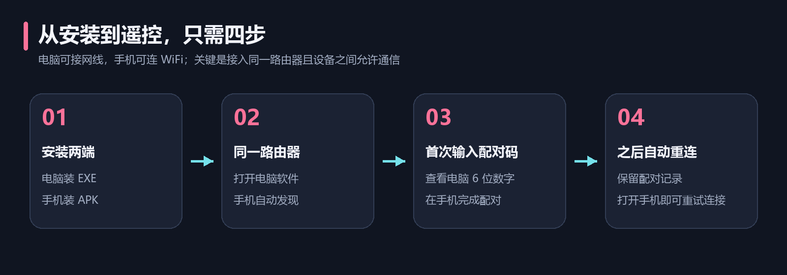
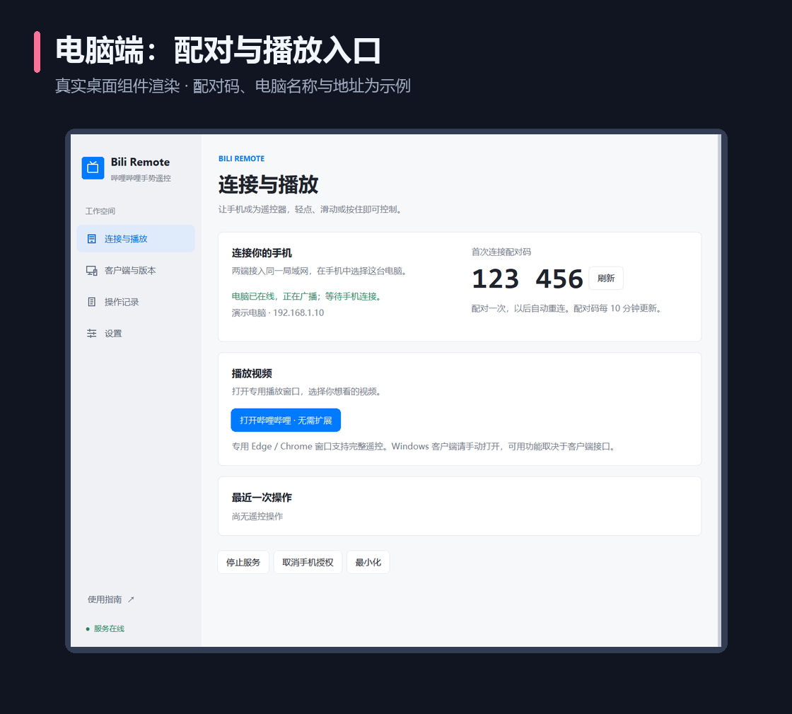
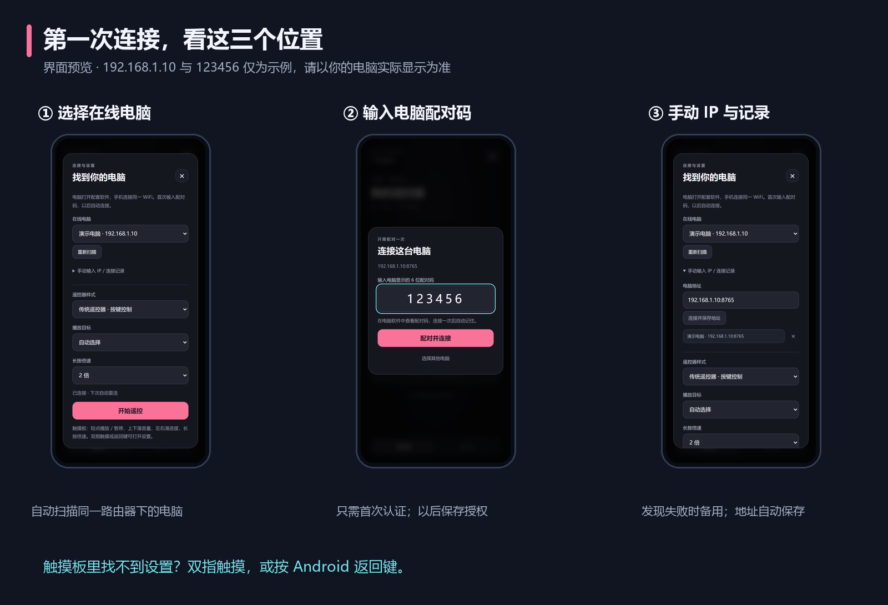
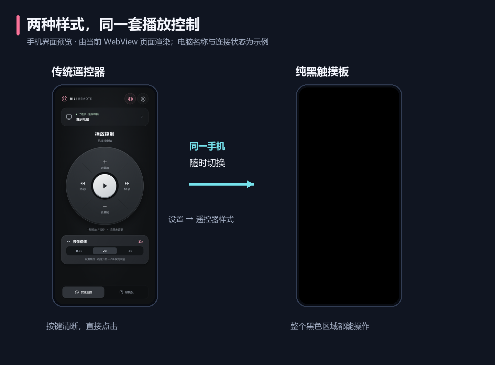

# 快速上手

[项目首页](../README.md) · [完整使用指南](USAGE.md) · [常见问题](FAQ.md)

目标：安装两端，首次配对，成功控制一段视频。

## 1. 准备两个安装文件

| 安装到哪里 | 文件 | 系统要求 |
| --- | --- | --- |
| 电脑 | `BiliRemote-Setup-0.5.3.exe` | Windows 10 1809 或更新，64 位 |
| 手机 | `bili-remote-0.5.3.apk` | Android 8 或更新 |

向维护者获取安装文件，或参考[开发说明](DEVELOPMENT.md)自行构建。GitHub 的 **Code → Download ZIP** 下载的是源码，不能当作安装包直接运行。文件名中的 `debug` 表示目前使用开发签名，手机仍可直接安装该 APK。

电脑打开 EXE 完成安装，手机打开 APK 并按系统提示允许本次安装来源、完成安装。已有旧版时直接安装新版，无需先卸载。

## 2. 让电脑和手机互相可见

把两端接入同一路由器。手机用 WiFi、电脑用网线也可以，电脑不必使用与手机相同的无线连接方式。

打开电脑端，确认“连接与播放”页显示电脑已在线。Windows 首次提示防火墙访问时，在可信家庭网络中允许本程序访问专用网络。

*此图由当前桌面组件渲染，电脑名称、地址、在线状态与 `123 456` 均为示例。使用时查看你自己的电脑实际显示。*

## 3. 在手机完成首次配对

1. 打开安卓端，等待扫描在线电脑。多台电脑时，在“在线电脑”中选择目标。
2. 手机出现“连接这台电脑”时，输入电脑端的 6 位配对码，不含显示时用于分组的空格。
3. 点击 **“配对并连接”**。连接成功后保存授权，下次不必再输入配对码。

没有自动出现电脑时，打开手机设置，展开 **“手动输入 IP / 连接记录”**，填写电脑端显示的 IPv4 地址，例如 `192.168.1.10`，点击“连接并保存地址”。这里的地址仅为示例，请使用你的实际地址。

纯黑触摸板里可用 **双指触摸** 或 **Android 返回键** 打开设置。仍无法连接时，按[常见问题](FAQ.md)中的顺序排查。

## 4. 在电脑打开可控制的视频

第一次使用建议先试网页播放：

1. 在电脑软件点击 **“打开哔哩哔哩 · 无需扩展”**；也可从手机 **“设置 → 播放器”** 点击 **“在电脑打开哔哩哔哩”**，两种遥控样式都能进入该设置。
2. 在软件打开的 Edge / Chrome 窗口中选一个视频，等待视频能够播放。
3. 如需登录，在这个窗口中登录哔哩哔哩。它使用独立资料，平时浏览器中的登录状态不会自动共享。

此窗口不需要安装扩展。遥控按键和触摸板手势不会自动启动播放器；请先按上述步骤主动打开。直接在平时浏览器里打开视频，无法保证被遥控。Windows 客户端请在电脑手动打开并播放视频，见[使用指南](USAGE.md)中的播放器选择说明。

## 5. 试一次暂停、音量和倍速

| 测试动作 | 触摸板操作 | 看到的效果 |
| --- | --- | --- |
| 暂停 / 播放 | 在任意位置轻点 | 视频暂停或继续，电脑短暂显示提示 |
| 调节音量 | 上滑 / 下滑 | 当前播放目标的音量变化 |
| 拖动进度 | 左右滑动 | 持续更新进度，一整屏对应 120 秒，松手提交最后位置 |
| 临时倍速 | 原地按住约 0.5 秒，保持按住后左右滑 | 默认 0.5 / 2 / 3 倍，从 2 倍起，左右换挡；松开恢复原速度 |

如果更习惯按钮，在设置中将“遥控器样式”切换为 **“传统遥控器 · 按键控制”**。

震动默认开启：长按触发和实际切换挡位时各轻震一次。在传统遥控器右上角点击震动图标，或在设置中关闭“震动反馈”，两种模式同时生效。

“设置 → 操作偏好”可关闭两种模式的操作提示，或展开“自定义倍速挡位”配置最多 5 挡。连续拖动和慢速挡位要求两端至少为 0.5.0；本次 0.5.3 的电脑交互性能修复只需更新 PC 端。

完成首次连接后，保持电脑端运行。以后打开手机 App，会使用保存的授权尝试自动重连。电脑离线、网络隔离或防火墙阻挡时，自动连接仍需先解决网络问题。
