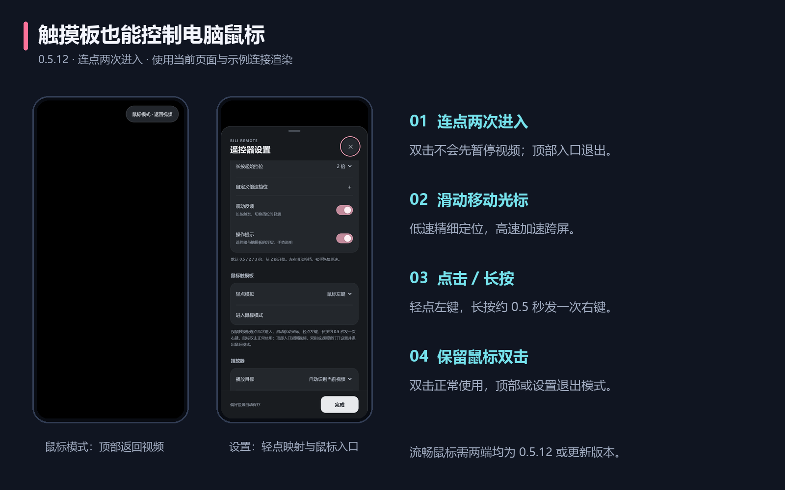
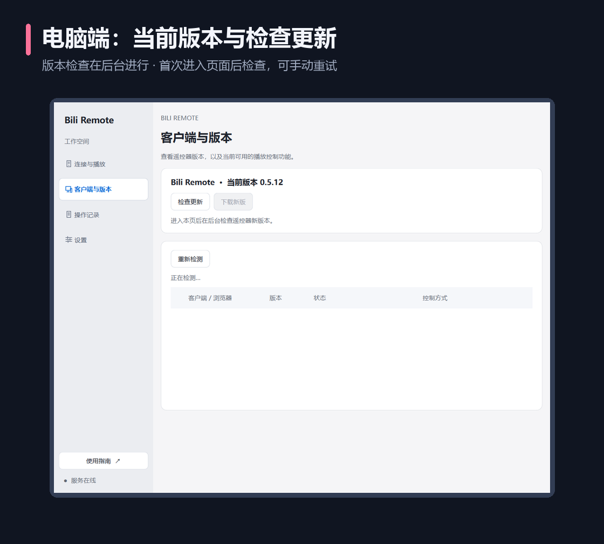
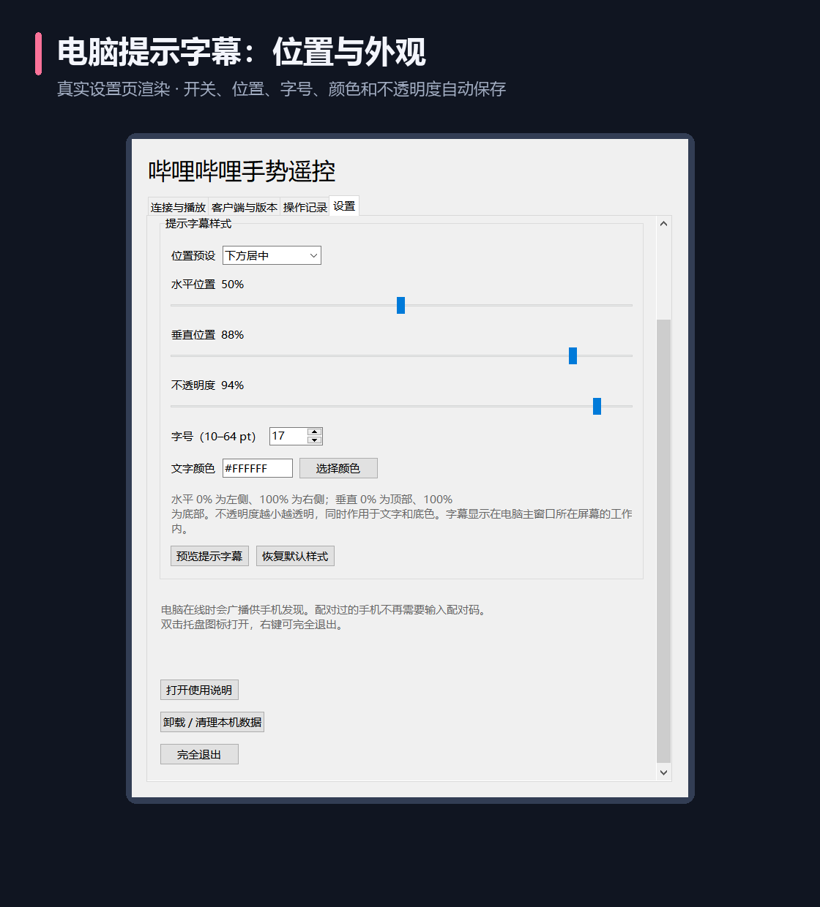
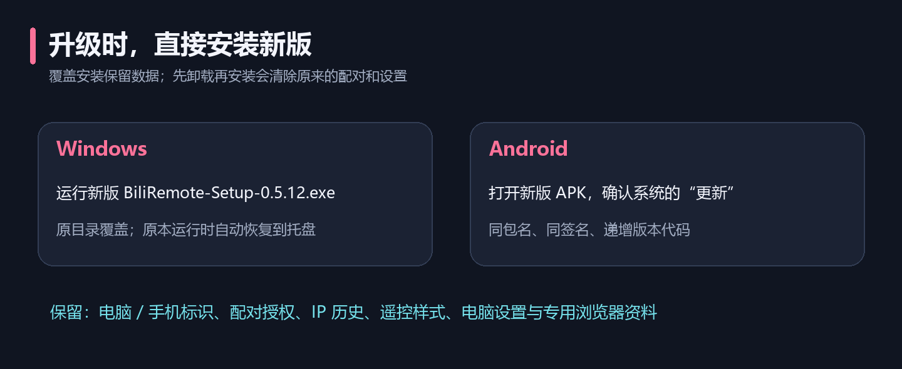

# 完整使用指南

[项目首页](../README.md) · [快速上手](QUICK_START.md) · [常见问题](FAQ.md) · [开发说明](DEVELOPMENT.md)

适用版本：**0.5.12**。配图使用当前代码渲染界面，连接信息均为示例；手势图上的触点和箭头是教学标注，不是 App 中常驻的按钮。

## 连接电脑

电脑端在线时周期性广播，安卓端同时扫描与监听。同一路由器下可以自动发现电脑，首次使用手机输入电脑显示的 6 位配对码。已配对手机使用保存的授权，下次直接重连。

| 情况 | 怎么做 |
| --- | --- |
| 第一次连接 | 选择在线电脑，输入该电脑显示的配对码 |
| 已经配对 | 打开两端软件，等待自动重连 |
| 电脑 IP 改变 | 保留原授权，手机通过电脑稳定标识重新寻找地址 |
| 有多台电脑 | 在“在线电脑”中选择目标；当前已连接时不会因发现另一台电脑而直接切换 |
| 自动发现失败 | 重新扫描，或展开“手动输入 IP / 连接记录” |
| 手动连接 | 填电脑 IPv4 地址，可省略默认 `:8765`，点击“连接并保存地址” |

手动输入的地址即使暂时离线也会保留。连接记录最多保存最近 10 条，可点击重连，或按右侧 `×` 删除一条记录。删除地址记录不等于在电脑端撤销手机授权。

配对码每 10 分钟刷新，刷新不影响已保存的手机授权。电脑端点击“取消手机授权”会撤销全部已配对手机的凭据，下次连接需要重新配对。配对码错误过多时，按提示等待约一分钟再试。

## 切换遥控器样式

在手机设置的 **“操作偏好 → 遥控器样式”** 中选择，设置自动保存。首次没有样式记录时默认使用触摸板，已有记录时沿用上次选择。

| 当前界面 | 打开设置 / 切换方式 |
| --- | --- |
| 纯黑触摸板 | 双指触摸，或 Android 返回键，进入设置 |
| 传统遥控器 | 右上角齿轮，或 Android 返回键，进入设置 |
| 传统遥控器底部 | 点击“触摸板”可直接切换为触摸板 |

触摸板界面保持纯黑是设计行为。连接及操作时可能短暂出现提示；平时不会铺满按钮。

## 使用触摸板

| 手势 | 操作效果 | 细节 |
| --- | --- | --- |
| 轻点任意位置 | 播放 / 暂停 | 等待 280 ms 区分双击；不要保持按住 |
| 连点两次 | 进入鼠标模式 | 同一区域连续轻点，不先暂停视频 |
| 上滑 / 下滑 | 增大 / 减小音量 | 滑动距离影响调节量，不调整整个电脑的系统主音量 |
| 右滑 / 左滑 | 连续拖动进度 | 滑动时更新，一屏对应 120 秒，松手提交最终位置 |
| 原地长按约 0.5 秒 | 临时倍速 | 松手恢复按下前的速度 |

横向滑过一个屏幕宽度对应 120 秒，按实际距离线性计算，不按整秒或 10 秒跳档。拖动时连续更新电脑上的进度，快速移动会合并请求，松手提交最后位置；可抬手从新位置继续拖动。视频起止边界会自动限位。开始滑动后锁定主要方向，避免一次操作同时调整音量和进度。

拖动开始时读取当前进度和实际可跳转范围，视频已变化或接口未开放时停止并反馈原因。进入后台、切换样式或取消触摸时丢弃尚未发送的位置，已提交的进度保留。播放器的关键帧、缓冲或客户端接口可能影响最终呈现精度。

长按默认从 **2 倍** 开始，默认挡位为 **0.5 / 2 / 3 倍**。保持按住后左滑降一挡、右滑升一挡；每次横移约 48 个界面像素换挡。轻微抖动、同挡停留或在首尾继续滑动不重复震动。长按期间不会快进 / 快退。

在 **“设置 → 操作偏好 → 自定义倍速挡位”** 选择 **1–5 挡**。每挡可选 **0.5、0.75、1、1.25、1.5、2、2.25、2.5、2.75、3 倍**，值不重复并自动按升序排列。“长按起始挡位”从已配置挡位中选择，两种遥控样式共用并自动保存。升级保留旧的 2 / 3 倍起始选择，未配置列表时使用上述默认三挡。

这里只调整遥控的临时挡位，不修改视频原本的播放速度。如果视频原本是 1.5 倍，松手仍恢复 1.5 倍，并非固定恢复 1 倍。

切换样式、触摸取消、进入后台、连接断开或心跳超时都会尝试释放临时倍速。播放器拒绝恢复时会反馈失败并重试；播放器进程被终止、页面已销毁时无法继续调用旧播放器。

## 鼠标模式

**流畅鼠标模式需要电脑端和安卓端都为 0.5.12 或更新版本。** 视频触摸板同一区域连续轻点两次即可进入；设置的“鼠标触摸板”也有直接入口。进入不要求先打开哔哩哔哩，控制对象是电脑光标。

| 手势 / 入口 | 效果 |
| --- | --- |
| 单指滑动 | 相对移动光标；抬手换位置继续滑动，光标不会跳到手机触点位置 |
| 轻点 | 默认模拟左键；可在设置的“轻点模拟”改为右键 |
| 原地长按约 0.5 秒 | 发送一次右键，按震动开关轻震一次；松开不再次点击 |
| 顶部“鼠标模式 · 返回视频” | 退出并恢复视频触摸板；关闭操作提示后仍可见 |
| 双指触摸 / Android 返回键 | 打开设置并退出鼠标模式 |
| 双击 | 正常鼠标双击，保持鼠标模式；退出请用顶部入口或设置 |

轻点与双击默认使用左键，长按使用右键。可在设置改变轻点映射；正常鼠标点击不增加视频模式的 280 ms 双击等待。当前提供光标移动、单击 / 双击和长按右键，尚不包含按住左键拖拽或双指滚轮。

光标低速精细定位，高速增益逐渐提高，短时间窗口估算速度，按帧发送累计位置并保留小数位移；移动不再等待每次回应。电脑用约 16 ms 的短缓存插值，输出目标间隔 8 ms，减少到包抖动；它会增加短暂缓存和调度等待，不预测手指下一步，也不产生持续惯性。进入后台、断线或退出时清除未发动作，不会在重新连接后继续回放旧动作。鼠标模式中的滑动和长按不调视频音量、进度或倍速。移动和点击不逐条显示电脑字幕或记录，以免高频更新干扰操作；进入、退出和失败仍可提示。

Windows 普通权限应用无法可靠控制更高权限窗口、UAC 安全桌面或锁屏。WiFi 延迟与手机采样影响实际手感，当前尚无实体 Android 或真实混合 DPI 多屏体验结论。加速度参数、队列策略和官方资料见[鼠标实现说明](MOUSE_CONTROL.md)。

## 使用传统遥控器

| 控件 | 操作 |
| --- | --- |
| 中央银白播放键 | 单击播放 / 暂停 |
| 圆环内左侧 / 右侧进度键 | 每次快退 / 快进 10 秒 |
| 播放键上方 `+` / 下方 `−` | 每次增加 / 减少音量 5% |
| 倍速键 | 按住进入临时倍速，保持按住后左滑降挡 / 右滑升挡，松开恢复原速度 |
| 右上角手机震动图标 | 开启 / 关闭震动反馈，粉色表示开启 |
| 设置 → 播放器 → 在电脑打开哔哩哔哩 | 主动打开专用网页播放窗口，触摸板模式也可使用 |
| 右上角齿轮 | 进入连接与设置 |

设置采用底部面板，分为连接电脑、操作偏好、播放器。内容可上下滚动，关闭与“完成”按钮始终可见；偏好修改即时保存。顶部设备卡片也可打开连接设置。手动地址与手势说明默认折叠。

倍速区的灰色挡位表示长按起始挡位，按住时当前挡位变为粉色。传统遥控器的倍速键按下即发起临时倍速，不需要等待触摸板的 0.5 秒长按判定。

## 震动反馈

震动默认开启，两种遥控样式共用一套设置。传统遥控器右上角的手机震动按钮可一键切换；触摸板使用双指触摸或 Android 返回键打开设置，调整“震动反馈”。开关状态会保存，重开 App 和覆盖升级时保留。

| 动作 | 震动 |
| --- | --- |
| 按住倍速键进入临时倍速 / 触摸板长按触发 | 轻震一次 |
| 按住后实际切换已配置挡位 | 每次换挡轻震一次 |
| 停在同一挡位、心跳、普通点击或滑动、松手 | 不震动 |
| 关闭震动反馈 | 所有上述遥控震动均关闭 |

安卓调用系统振动器，不要求运行时授权弹窗；设备没有振动器或系统限制震动时，播放控制仍可使用。网页预览中浏览器可能不支持震动，实际手感和强度仍需实体手机验证。

自定义慢速挡位与连续进度拖动需要电脑端和安卓端至少为 **0.5.0**。0.5.9 更换统一双缓冲绘制层，0.5.10 增加浏览器选择和实际通道显示；旧安卓仍可继续基本视频控制。新增鼠标模式从 0.5.11 提供；流畅度修复需要两端均更新至 **0.5.12**。

## 关闭手机操作提示

在 **“设置 → 操作偏好”** 关闭 **“操作提示”**，遥控器与触摸板的操作浮层、主界面手势说明都会隐藏，开关会保存。挡位高亮、连接状态、音量读数仍可查看。关闭提示后，失败原因可在手机设置的“播放器”下方或电脑操作记录中查看；震动由单独开关控制。

## PC 窗口与分辨率

电脑采用浅灰侧栏、白色分组卡片和蓝色主操作。页面铺满侧栏右侧区域，保留左右 16 个逻辑像素内边距；宽窗口并排显示连接信息与配对码，窄窗口上下排列、侧栏收起为图标。按钮行换行，小窗口可通过滚轮、滚动条或键盘查看底部操作。Alt+1 / 2 / 3 / 4 分别进入连接、客户端、记录、设置；Tab 跳过隐藏页。

当前主界面沿用 0.5.9 引入的 Qt Widgets 光栅双缓冲，不再创建分层子窗口滚动缓存；四页只构造一次，仅当前页可见，切页没有动画，保留滚动与编辑状态。窗口 DPI 与绘制使用同一套逻辑坐标。此前检查过 32 组窗口与 Qt 缩放组合，实际跨显示器 DPI 切换仍需实机补测。安装器展开运行依赖，启动无需重复解压；安装目录的 EXE 需要同目录 `_internal`，请勿单独移动。

### 查看遥控器版本与更新

电脑侧栏进入 **“客户端与版本”**，上方显示 **“Bili Remote · 当前版本 0.5.12”**。这里的当前版本是遥控器自身版本；下方表格仍显示哔哩哔哩 / 浏览器的版本与控制能力。

首次进入时在后台查询 GitHub 最新正式发布版，结果缓存约一小时；点击 **“检查更新”** 会重新联网检查。API 被限流时使用 GitHub 官方发布网页备用路径，无需个人访问令牌。离线或失败会明确显示原因，可稍后重试，不会把失败显示成“已是最新”。

发现新版后点击 **“下载新版”**，在默认浏览器打开对应的电脑安装包下载。下载后运行新版安装器直接覆盖安装，配对和设置保留。当前版本比公开正式版更新时会同时显示两者版本。程序不会在后台自动下载安装或重启。

## 选择播放目标

手机设置中的“播放目标”提供三种选择：

| 选项 | 行为 | 适合场景 |
| --- | --- | --- |
| 自动识别当前视频 | 核对前台窗口、网页活动状态和媒体会话；不确定或多个目标时要求手选 | 希望避免误控后台窗口 |
| 专用网页窗口 · 完整控制 | 控制软件主动打开的 Edge / Chrome 窗口 | 视频音量、连续进度和临时倍速 |
| 系统媒体 / 客户端 · 按接口能力 | 明确选择普通浏览器或 Windows 客户端会话 | 保留普通浏览器的播放方式，接受接口能力限制 |

“最近确认目标”显示的是最近一次成功操作 / 主动打开所确认的浏览器与通道，不是持续监控的当前前台窗口。切换配置后先操作并核对结果；失败时保留此前成功目标作为历史信息。

### 手动打开的普通 Edge / Chrome

1. 在该浏览器中播放视频。
2. 手机“设置 → 播放器”选择 **“系统媒体 / 客户端”**，点击 **“检测浏览器 / 客户端”**。
3. 选择明确的 Edge 或 Chrome 媒体会话；列表显示暂停、进度、倍速的实际开放能力。

系统接口经常只提供暂停与进度；没有开放的倍速不会被软件补出，也不会改去控制后台专用窗口。该接口不能调整单个视频音量，软件会提示改用完整网页控制。同一浏览器多个媒体会话可能共享相同标识，无法区分时请只保留一个播放标签页，或使用专用窗口。

### 完整控制的专用窗口

在手机选择 **“打开网页时使用 → Microsoft Edge / Google Chrome”**，再点击 **“在电脑打开哔哩哔哩”**；电脑连接页也可选择。手机成功打开后切到“专用网页窗口”，实际目标会显示浏览器名称。在弹出的窗口中选择视频，可控制暂停、进度、视频音量和临时倍速，不需要安装插件。

Edge 和 Chrome 各自保存独立登录资料，原 Edge 资料沿用；Chrome 首次可能需要重新登录。普通遥控操作不会打开浏览器，切换浏览器选项也不会关闭已有窗口。电脑程序完全退出会关闭本软件管理的专用播放窗口，普通浏览器不受影响。

自动模式不会因为后台专用进程存在就直接选它；前台浏览器无可确认的视频、多目标或专用页面隐藏且暂停时会要求确认。只有一个活动完整网页目标时可使用其网页接口，系统会话与该网页的重复信息按本机窗口进程核对。详细边界见[浏览器控制说明](BROWSER_CONTROL.md)。

### Windows 客户端

先在电脑客户端中播放视频，再从手机选择“Windows 客户端”，点击“检测客户端”，必要时手动选媒体会话。电脑“客户端与版本”页也能查看运行状态、检测到的版本与可用能力。

暂停、进度、倍速受客户端实际提供的接口约束；有些版本只开放部分功能。客户端音量使用应用音频会话，找不到相应音频进程时会明确报错，不会改动整个电脑的系统主音量。需要排查音频进程时见[开发说明](DEVELOPMENT.md)。

版本检测不等于完成了该版本的全部适配，不能据此承诺“所有客户端版本完整兼容”。

## 电脑提示与操作记录

成功或失败的遥控操作会在电脑上显示短暂浮层，包含暂停、跳转、音量、临时倍速或失败原因。提示不激活窗口，不抢播放器焦点。

“连接与播放”页显示最近一次操作；“操作记录”页保留本次运行最近 100 条记录，重新启动后重新开始记录。桌面提示可在设置中关闭。

在电脑端 **“设置 → 提示字幕样式”** 调整，修改自动保存，重启及覆盖升级时保留：

| 设置 | 行为 |
| --- | --- |
| 开启遥控提示字幕 | 关闭后立即隐藏并释放字幕窗口，操作记录仍保留 |
| 位置预设 | 左上、上方居中、右上、左侧居中、屏幕中央、右侧居中、左下、下方居中、右下 |
| 水平 / 垂直位置 | 0%–100% 连续调整，字幕整体限制在主窗口所在屏幕工作区内 |
| 字号 | 10–64 pt，按显示器 DPI 换算 |
| 文字颜色 | 使用颜色选择器，或输入 `#RRGGBB`；失败提示保留“失败”文字前缀 |
| 不透明度 | 10%–100%，越小越透明，同时作用于文字和底色 |
| 预览 / 恢复默认 | 立即预览当前样式，或恢复下方居中、17 pt、白色、94% 不透明度 |

字幕显示约 1.5 秒，新的操作会替换内容并延长显示；不抢播放器焦点、不拦截鼠标。关闭字幕不关闭遥控服务、最近操作和操作记录。

### 直接拖动与持续预览

设置中的示例字幕会持续预览当前样式。直接拖动示例字幕可调整位置，选中后用方向键按 1% 微调；位置预设和滑块也能精确设置。

点击 **“在屏幕上拖动字幕”** 打开实际大小的预览。它会持续显示，可直接拖动；字号、颜色与透明度修改实时同步，停止拖动约 250 ms 后自动保存。页内画面用于位置与样式示意，实际字号与透明度以屏幕预览为准。按 Esc、点击“结束屏幕预览”、离开设置或最小化主窗口即可结束。正常遥控提示仍短暂显示、鼠标穿透，不会遮挡播放器操作。

[完整设计说明与参考资料](DESKTOP_DESIGN.md)

## 后台内存

0.5.1 将字幕窗口改为首次使用时创建；客户端检测仅在“客户端与版本”页可见或手动请求时运行。后台待机不再持续读取媒体接口，版本检测结果不变时不重建表格，进程枚举只查询相关目标并释放缓存。需要控制 Windows 客户端时仍会加载对应的媒体及音量组件。

内存对比使用独立身份、同一台电脑、两端口隔离的真实打包程序：后台运行、服务在线、不连接手机、不打开播放器，分别重复 3 次，包含单文件启动器和主进程，报告工作集及私有字节的中位数。没有通过强制裁剪工作集来制造下降。测量脚本见开发说明，实测报告随 [0.5.1 发布页](https://github.com/Nichijin/bili-remote/releases/tag/v0.5.1) 提供；控制客户端或浏览器播放时的占用会变化，浏览器本身的内存另计。

手机收到“命令成功”表示目标接口接受了操作；若播放器尚无视频、接口拒绝请求或客户端不支持功能，应查看具体错误提示。

## 托盘与开机自启

| 设置 / 操作 | 效果 |
| --- | --- |
| 登录 Windows 后自动启动 | 登录当前 Windows 账户后启动到托盘；首次安装默认关闭 |
| 关闭窗口时保留在系统托盘运行 | 默认开启，关闭主窗口后仍接收遥控 |
| 开启遥控提示字幕 | 默认开启，可关闭并调整位置、字号、颜色及不透明度 |
| 最小化 | 有托盘时隐藏到托盘，服务继续运行 |
| 双击托盘图标 | 恢复主窗口 |
| 托盘右键 → 退出 / 设置 → 完全退出 | 结束电脑端及专用播放窗口 |
| 重复打开程序 | 唤回已有实例，避免启动第二个服务 |

“最小化到托盘”需要 Windows 托盘功能可用。若托盘初始化失败，程序会使用普通最小化或关闭行为。

## 覆盖升级

**电脑和手机均直接安装新版，不要先卸载，也不要清除应用数据。** 当前不提供自动下载新版的功能。

| 平台 | 操作 | 保留内容 |
| --- | --- | --- |
| Windows | 运行新版 `BiliRemote-Setup-0.5.12.exe`，自动沿用注册的旧安装目录 | 电脑标识、手机授权、电脑设置、实际自启状态、专用浏览器资料 |
| Android | 打开新版 APK，确认系统“更新” | 手机标识、授权凭据、手动 IP 历史、样式、目标和倍速设置 |

Windows 升级前若程序正在运行，安装器会先正常退出它，完成后恢复到托盘。手机的连接会短暂断开；专用播放窗口也会关闭，升级后可重新打开。原本没有运行时，可按安装完成页的选项打开程序。

新 Windows 安装器支持同版本修复，拒绝用较低版本降级。安卓覆盖更新要求包名一致、签名一致，发布新版还必须递增版本代码；系统会要求用户确认安装，普通 App 不能绕过。

手机若提示签名冲突，不要为解决提示而先卸载旧版；应由维护者提供使用原签名的 APK。旧版若是自己在 Android Studio 用另一把默认密钥构建的，需要沿用当时的签名。

Windows 升级已使用独立身份验证；安卓已核对旧新 APK 的包名、证书及版本代码，尚无实体手机覆盖测试。保留浏览器资料不代表网站登录永不过期。

## 撤销授权与卸载

电脑端“取消手机授权”会让已连接手机断开，并要求下次重新配对。它不会卸载两端软件。

电脑安装版可从 **Windows 已安装的应用** 或软件设置中的 **“卸载 / 清理本机数据”** 卸载。卸载将停止电脑端，删除程序、快捷方式、启动项、安装登记、本机设置、授权、日志及专用播放窗口的浏览器资料。不会删除哔哩哔哩客户端或普通浏览器的数据。清理已存在的程序防火墙规则可能要求管理员授权，失败会提示或写日志。

安卓端按系统方式卸载。卸载或清除应用数据会删除本机配对与设置，重新安装后需要重新配对。只是安装新版时不要执行这些清理操作。
